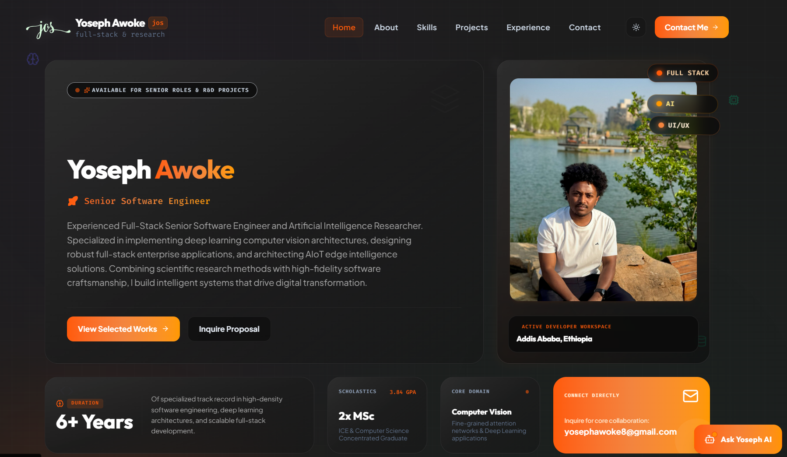

<div align="center">
  <h1>🚀 Yoseph Awoke — Portfolio</h1>
  <p>Full-stack & AI-focused engineer — personal portfolio showcasing projects, experience, and contact.</p>
</div>

---

**Preview**



---

**About**

- A concise, modern portfolio built with TypeScript, React, and Vite. It highlights project case studies, technical experience, and an interactive chatbot for quick inquiries.

**Highlights**

- Clean responsive UI with light/dark themes
- Project case studies with live demos and repository links
- Interactive AI-powered chat assistant (local API integration)
- Accessible, animated components and timeline

**Tech Stack**

- React + TypeScript
- Vite
- TailwindCSS
- Motion for UI animations
- Express (server-side API)

**Quick Start**

Prerequisites: Node.js (>=16)

Install dependencies:

```bash
npm install
```

Run development server:

```bash
npm run dev
```

Build for production:

```bash
npm run build
```

Preview the production build:

```bash
npm run preview
```

**Vercel Deployment (serverless)**

If you choose Vercel, you can deploy the frontend and the chat endpoint as serverless functions. Steps:

1. Push your repo to GitHub.
2. Add the project in Vercel and connect your GitHub repo.
3. In Vercel Project Settings → Environment Variables add `GEMINI_API_KEY` (value from your secrets).
4. Ensure Vercel builds the app with the framework preset (Vite) or set build command `npm run build`.
5. Deploy — the chat endpoint is available at `/api/chat` and will call Gemini using the server-side secret (key is never exposed to the browser).

Notes:
- Serverless functions have execution limits and are best for short request/response operations (chat single-turn calls). For streaming or very high throughput, consider Render/Fly.
- Don't commit any `.env` files to the repository.

**Environment variables for production**

Set these in your hosting dashboard (Vercel/Render):

- `GEMINI_API_KEY` — required for `/api/chat` to call Gemini server-side.
- `SENDGRID_API_KEY` — optional, to enable `/api/contact` email delivery via SendGrid.
- `CONTACT_RECEIVER_EMAIL` — email to receive contact messages (used with SendGrid).
- `CONTACT_FROM_EMAIL` — optional `from` address for contact emails (defaults to `no-reply@portfolio`).
- `CONTACT_WEBHOOK_URL` — optional alternative to SENDGRID: forward contact payloads to this webhook.

**Testing serverless endpoints locally**

You can test the API routes locally before deploying by running your local server (`npm run dev`) which currently serves `server.ts`. Alternatively, use Vercel CLI to emulate serverless functions locally:

```bash
npm i -g vercel
vercel dev
```


**Project Structure (key files)**

- `index.html` — app entry
- `src/main.tsx` — React bootstrap
- `src/App.tsx` — main layout and routes
- `src/components/` — UI components (Hero, Projects, Chatbot, etc.)
- `src/assets/images/portfolio-landing-page.png` — landing page screenshot used above
- `server.ts` — local server / API

**Notes**

- If you clone the repo, run `npm install` first so editor type declarations and packages are available.
- To reset TypeScript server in VS Code if you see stale diagnostics: open Command Palette → `TypeScript: Restart TS Server`.

**Contact**

If you'd like help customizing the site, improving accessibility, or adding deployments, open an issue or contact me via the links on the site.

---

Made with ❤️ — Yoseph
